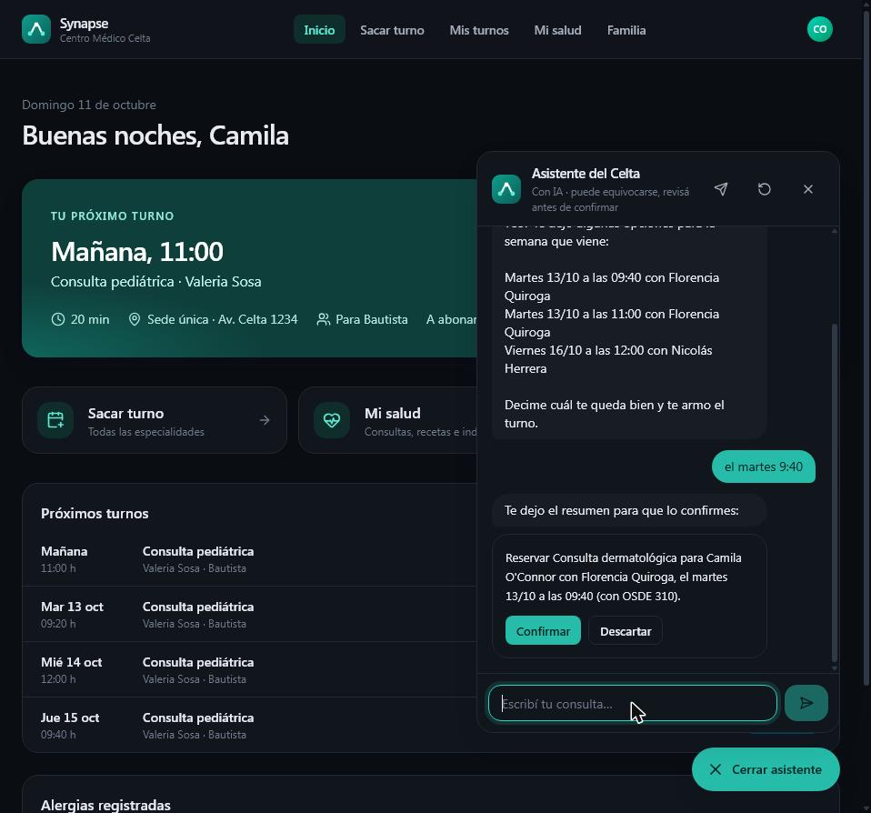
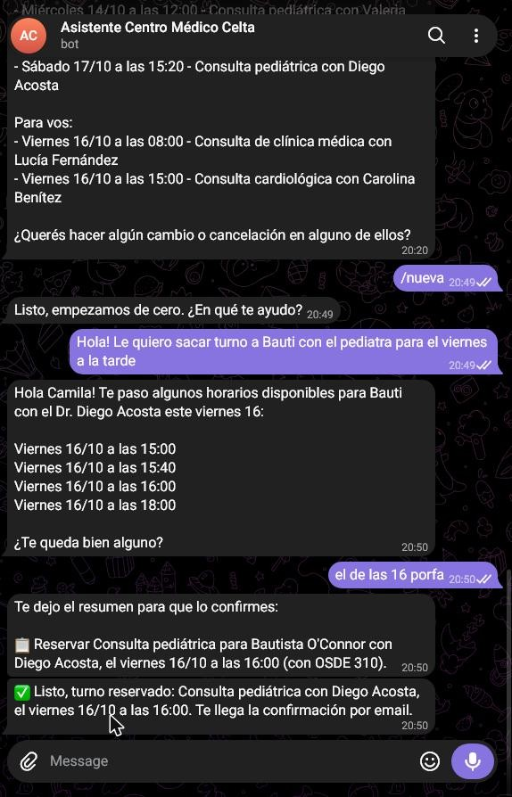
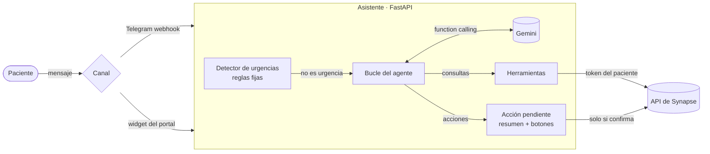

<div align="center">

# Asistente del Centro Médico Celta

**Un agente con IA que saca, cambia y cancela turnos médicos conversando, sobre la API real de [Synapse](https://github.com/Fraqqqq/synapse).**

[Probalo en Telegram](https://t.me/celta_asistente_fraqqqq_bot) · [Decisiones de diseño](docs/adr/) · [Evaluaciones](evals/RESULTADOS.md)


</div>

> Proyecto de la materia **Learning Agility**: aprender una tecnología nueva (agentes con LLM y *function calling*) construyendo algo real. El Centro Médico Celta es ficticio y **todos los datos son inventados**.

| Portal del paciente (Synapse) | Telegram |
|---|---|
|  |  |

## Qué hace

El paciente escribe como le escribiría a la recepción: *"le quiero sacar turno a Bauti con el pediatra para el viernes a la tarde"*. El asistente:

1. entiende **para quién** es (el paciente o un hijo a cargo), **qué** prestación y **cuándo** ("el viernes", "la semana que viene", "a la tarde");
2. consulta la **agenda real** de Synapse y ofrece horarios libres;
3. arma la reserva y le muestra al paciente un **resumen con botones Confirmar y Descartar**: nada se ejecuta sin su confirmación;
4. también muestra sus turnos, calcula **cuánto paga** según su obra social, **reprograma** y **cancela** (respetando el plazo de 24 h), y responde dudas del centro.

Funciona en dos canales con el mismo agente: **Telegram** y un **chat dentro del portal del paciente** de Synapse.

## Cómo funciona



- **El modelo propone, la persona confirma.** Reservar, cambiar y cancelar no ejecutan nada: el código valida contra Synapse (incluido que el horario **esté realmente libre**), arma el resumen y espera el botón. El resumen lo escribe el código, no el modelo, así que lo que se confirma es exactamente lo que se ejecuta ([ADR 0002](docs/adr/0002-confirmacion-humana.md)).
- **Sin más permisos que el paciente.** El asistente no toca la base de Synapse: usa el token del propio paciente. Aunque el modelo sea manipulado, Synapse rechaza todo lo que ese paciente no podría hacer ([ADR 0003](docs/adr/0003-identidad.md)).
- **Las urgencias no dependen de la IA.** "Me duele el pecho y no puedo respirar" se detecta con reglas antes de llamar al modelo y responde siempre con el 107 (SAME), aunque Gemini esté caído ([ADR 0004](docs/adr/0004-urgencias-por-reglas.md)).
- **Lo que el modelo calcularía mal se lo da el código.** Los modelos se equivocan con "el jueves que viene", así que reciben un calendario de los próximos 21 días ya resuelto, el catálogo con sus ids y el grupo familiar. Eso además ahorra llamadas.
- **Costo cero y resiliente.** Usa el free tier de Gemini con una lista de modelos de respaldo: reintenta ante saturación (503) y saltea por un rato un modelo sin cuota (429) ([ADR 0001](docs/adr/0001-modelo.md)).

## Calidad

| | |
|---|---|
| **64 tests** (pytest) | Con un modelo guionado y Synapse/Telegram simulados ([respx](https://lundberg.github.io/respx/)): no gastan cuota y corren en CI. Cubren el bucle del agente, validaciones, confirmaciones, vencimientos, aislamiento entre pacientes, Telegram y el adaptador de Gemini. |
| **16 evaluaciones** con Gemini real | Comprensión de pedidos, uso de herramientas, acciones con confirmación, urgencias, consejo médico, temas ajenos y *prompt injection*. **16/16 aprobadas**, mediana de 2,4 s por caso ([resultados](evals/RESULTADOS.md)). |
| **Lint** | Ruff (estilo, imports, bugs comunes y async). |

Las evaluaciones sirvieron para tomar decisiones con datos. Por ejemplo, descubrieron que el free tier de los modelos *flash* da solo 20 pedidos por día, y que `gemini-3.1-flash-lite` tardaba 22 s contra 2,5 s de `gemini-flash-lite-latest`.

## Integración con Synapse

El asistente consume la API de Synapse tal como está, salvo dos agregados que viven en el repo de Synapse ([ADR 0007 de Synapse](https://github.com/Fraqqqq/synapse/blob/main/docs/adr/0007-asistente-con-ia.md)):

- `POST /api/integraciones/asistente/token`: canje de token con clave de servicio, para que el bot de Telegram opere en nombre del paciente vinculado.
- El **widget de chat** del portal, hecho con el design system de Synapse, con navegación por teclado y `aria-live` para lectores de pantalla.

## Stack

| | |
|---|---|
| Agente | Python 3.12 · FastAPI · SDK `google-genai` (function calling manual) · httpx |
| Persistencia | SQLAlchemy 2 (SQLite en desarrollo, PostgreSQL en producción) |
| Canales | Telegram Bot API (webhook en producción, *long polling* en desarrollo) · widget React en Synapse |
| Calidad | pytest · respx · Ruff · GitHub Actions |
| Infraestructura | Docker · Render |

## Cómo correrlo

Necesita una instancia de Synapse ([cómo correrla](https://github.com/Fraqqqq/synapse#cómo-correrlo)) y una key gratuita de [Google AI Studio](https://aistudio.google.com/apikey).

```bash
python -m venv .venv && .venv/Scripts/activate      # en Linux/macOS: source .venv/bin/activate
pip install -r requirements-dev.txt
cp .env.example .env                                 # completar GEMINI_API_KEY y SYNAPSE_URL

python -m app.consola                                # chat por consola
python -m app.canales.sondeo                         # bot de Telegram (necesita TELEGRAM_BOT_TOKEN)
uvicorn app.main:app --port 8200                     # API para el widget del portal

pytest                                               # tests (sin red ni cuota)
python -m evals.correr                               # evaluaciones con Gemini real
```

## Limitaciones y próximos pasos

- En el free tier, Google puede usar los datos para mejorar sus modelos: con datos ficticios no es un problema, pero con pacientes reales habría que usar el plan pago o Vertex AI ([ADR 0001](docs/adr/0001-modelo.md)).
- La demo pública opera como una paciente ficticia compartida. La vinculación real por paciente ya está implementada y testeada (`CREDENCIALES_MODO=intercambio`).
- Próximos pasos: notas de voz (Gemini acepta audio), recordatorios proactivos por Telegram y la **app mobile del paciente** en *Programación Mobile*, sobre la misma API.
